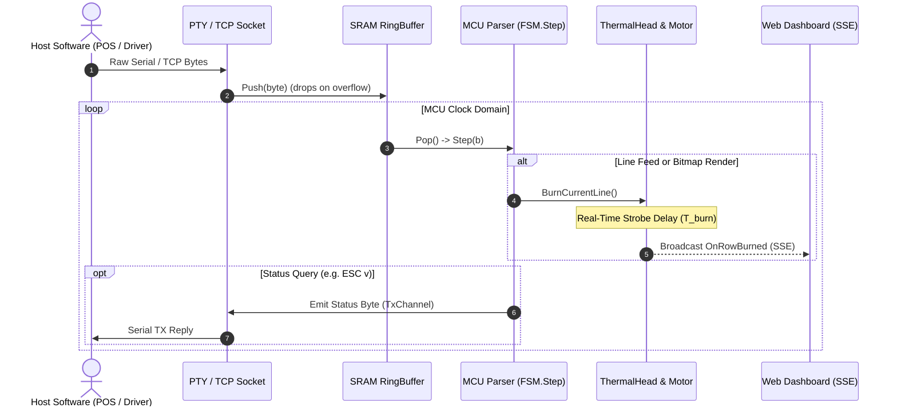

# ThermalSim — System Architecture & Design Documentation

## 1. Architectural Overview

`ThermalSim` is structured in four loosely coupled layers to guarantee **Separation of Concerns (SoC)**, **Single Responsibility Principle (SRP)**, and ease of adding other thermal printer models:

```
ThermalSim/
├── cmd/
│   └── thermalsim/         # CLI entry point (Daemon & Headless modes)
├── pkg/
│   ├── transport/          # Byte I/O: POSIX PTY, TCP, UART physics & ring buffer
│   ├── printer/            # Generic thermal printer engine: FSM, ThermalHead, Registers
│   ├── models/
│   │   └── qr203/          # QR203/CSN-A2 profile, fonts, code pages, barcodes, QR, quirks
│   └── ui/                 # Presentation: embedded Web UI, WebSockets, PNG renderer
├── doc/                    # System documentation and hardware references
├── scripts/                # Verification and client test scripts
├── LICENSE                 # Project MIT License
├── README.md               # Quickstart, visual showcase, and CLI reference
└── ARCHITECTURE.md         # This architectural specification
```

---

## 2. Concurrency & Timing Architecture

In physical thermal printers, two distinct clock domains operate simultaneously:
1. **The UART Receiver Domain:** Driven by the serial line baud clock. Bytes arriving on RX trigger hardware interrupts that place bytes into an internal SRAM ring buffer and assert flow control (DTR/RTS) when near capacity.
2. **The MCU & Mechanical Domain:** A sequential main loop that fetches bytes from the ring buffer, updates state registers, renders glyphs into the dot-line buffer, and periodically activates thermal head strobes and the stepper motor to feed paper.



### Concurrency Model in Go:
- **`transport.PTYBridge` / `transport.TCPBridge`**: Reads raw serial bytes and deposits them into `transport.RingBuffer`. If the ring buffer is full because the printhead is busy and the host ignored flow control, bytes are dropped and counted.
- **`printer.FSM` Execution Loop**: Runs concurrently with the transport layer. In real-time physics mode, when a line print or paper feed occurs, the loop pauses for the calculated burn duration:
  $$T_{\text{burn}} = N_{\text{strobe\_groups}} \times (T_{\text{heat}} + T_{\text{interval}}) + T_{\text{break}} + T_{\text{step}}$$
  This natural pause causes the ring buffer to fill up if the host continues streaming unthrottled data, accurately replicating real hardware buffer overflow bugs.
- **Instant Mode**: For automated CI testing, the physics delays can be set to zero, executing tests at maximum memory speed while retaining 100% byte-accurate state-machine behavior.

---

## 3. Pluggable Printer Profile Interface (`printer.Profile`)

Adding a new printer model requires implementing only the `printer.Profile` interface:
```go
type Profile interface {
    Name() string
    DotsPerLine() int          // e.g. 384 for QR203 (58mm), 576 for 80mm
    BytesPerLine() int         // DotsPerLine / 8
    DefaultBaudRate() int      // e.g. 19200
    ReceiveBufferSize() int    // e.g. 4096 (QR203 v2.69) or 256 (v2.16 legacy)
    DefaultLineSpacing() uint8 // e.g. 30 or 32 dots
    FirmwareVersion() FirmwareRevision
    RenderChar(code byte, font FontType, codePage int, intlSet int) []byte
    BarcodeSupported(m int) bool
    QRCodeSupported() bool
}
```

The core state machine (`printer.FSM`), thermal head (`printer.ThermalHead`), and transport layers interact exclusively through this interface, ensuring that changes to command dialects or printer dimensions never bleed into I/O or rendering code.
