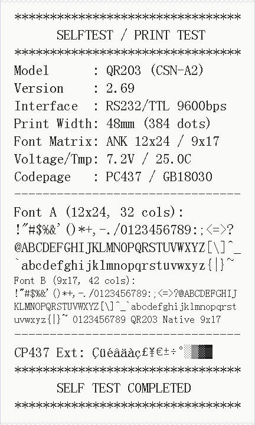
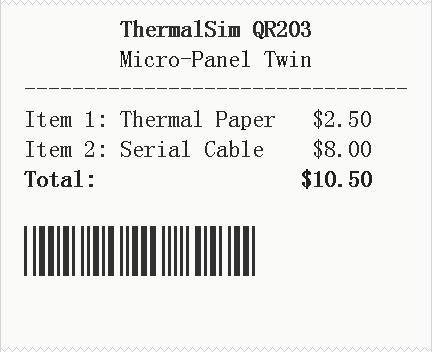

# ThermalSim

> **Zero-Knowledge, Hardware-Accurate Digital Twin for ESC/POS Thermal Receipt Printers**

[](https://golang.org)
[](LICENSE)
[](#cross-platform-compatibility)
[-brightgreen)](pkg/)

**ThermalSim** is an embedded hardware simulator designed as a drop-in replacement for physical ESC/POS thermal printers during development, CI/CD testing, and host software debugging.

Unlike typical receipt formatters or high-level document parsers that translate ESC/POS into HTML or PDF, ThermalSim operates strictly **byte-by-byte** as a true digital twin: it replicates internal MCU registers, 384-dot line composition buffers, CGROM character bitmasks, stepper motor paper feeds, SRAM ring-buffer overflow drops, and authentic firmware quirks.

---

## Visual Showcase

ThermalSim renders every single dot row exactly as the physical thermal head burns it:

| Hardware Self-Test Diagnostic (`DC2 T`) | End-to-End Formatting & Barcode Demo |
| :---: | :---: |
|  |  |

---

## Note on Project Conception & Implementation

> [!NOTE]
> **Project Origin & Methodology:**
> The architectural design, zero-knowledge emulation philosophy, firmware state machine specifications, and hardware profiling of this project were **conceived and designed by human hands**. The code implementation, unit test suites, and documentation were realized in pair-programming collaboration with an **LLM (Large Language Model)**.

---

## Key Features

- **Byte-Accurate ESC/POS State Machine:** Processes serial byte streams byte-by-byte without lookahead or high-level assumptions.
- **Native CGROM Fonts:** Pixel-perfect embedded dot-matrix ROM tables matching original printer firmware:
  - **Font A:** 12×24 dot matrix (32 characters per 384-dot line)
  - **Font B:** 9×17 dot matrix (42 characters per 384-dot line)
  - **Kanji:** 24×24 dot matrix (16 Chinese/Kanji glyphs per line)
  - **Code Pages:** CP437, CP850, CP858 (Euro symbol `€`), WCP1252, and 16 international character sets (`ESC R 0..15`).
- **Faithfully Reproduced Hardware Quirks & Failure Modes:**
  - **Blind Byte-Count Lockup:** In bitmap graphics modes (`DC2 *`, `DC2 V/v`, `GS v 0`), if the host transmits fewer bytes than specified in the header, the printer enters raw consumption mode and swallows subsequent commands and text as bitmap pixels.
  - **UART SRAM Buffer Overrun:** Data streamed faster than the simulated printhead can burn and feed dots without hardware handshaking drops bytes exactly like an unbuffered hardware UART ISR.
  - **Mid-Line Barcode Rejection:** Sending `GS k` when the line buffer is non-empty aborts barcode processing and dumps the barcode payload as printable text.
  - **Single-Line Double Width:** `ESC SO` automatically resets on line feed, whereas `ESC !` double-width persists across lines.
  - **Bidirectional Status Behavior:** On `GS r`, if paper is out, the printer transitions offline and drops subsequent queries per hardware specification.
- **Real-Time Physics Simulation (`-realtime`):**
  - Configurable strobe heating duration (`ESC 7`) and print density (`DC2 #`).
  - Thermal head heating and cooling dynamics with 5-blink overheat shutdown (>60°C).
  - Low-voltage brownout stall simulation (<4.5V).
- **Interactive Web Dashboard:**
  - Rolling virtual receipt canvas with real-time Server-Sent Events (SSE) streaming.
  - Virtual Hardware Switchboard: toggle paper out, cover open, head temperature, and voltage sag.
  - Live Byte Logic Analyzer: real-time inspection of incoming bytes and MCU state transitions.
- **Zero Third-Party Runtime Dependencies:**
  - Written entirely using the Go standard library (`net/http`, `image/png`, `embed.FS`, `syscall`). Compiles to a single standalone binary.

---

## Cross-Platform Compatibility

ThermalSim is designed to run seamlessly across all major operating systems:

| Feature | Linux | macOS (Darwin) | Windows |
| :--- | :---: | :---: | :---: |
| **POSIX Virtual Serial (PTY)** | ✅ Native (`/dev/ptmx`) | ✅ Native (`/dev/ptmx`) | ⚠️ via TCP Bridge / com0com |
| **Raw TCP Socket Bridge** | ✅ (`:9100`) | ✅ (`:9100`) | ✅ (`:9100`) |
| **Live Web UI Dashboard** | ✅ (`:8080`) | ✅ (`:8080`) | ✅ (`:8080`) |
| **Headless PNG Batch Mode** | ✅ | ✅ | ✅ |

### Notes for Windows Users
On Windows, POSIX `/dev/ptmx` is not natively available. ThermalSim runs seamlessly using the built-in **Raw TCP Socket Bridge** (`-tcp :9100`):
- Connect host software directly to TCP port `9100` (supported by many POS libraries such as `python-escpos`, printer spoolers, or socket connections).
- To map the TCP port to a legacy Windows COM port (e.g., `COM3`), you can use tools like [com0com](http://com0com.sourceforge.net/) combined with `hub4com`, or a serial-to-TCP redirector.

---

## Quick Start

### 1. Build from Source
```bash
# Clone the repository
git clone https://github.com/matteosusca/ThermalSim.git
cd ThermalSim

# Build binary
go build -o bin/thermalsim ./cmd/thermalsim
```

### 2. Interactive Daemon Mode
Start ThermalSim with the Web UI and virtual serial port:
```bash
./bin/thermalsim -http :8080 -pty /tmp/qr203-tty0 -tcp :9100
```
- Open **http://localhost:8080** in your browser to watch the live paper roll.
- Point your software to `/tmp/qr203-tty0` (or `localhost:9100`).

### 3. Send Test Data (Python Demo Client)
```bash
# Send test receipt via virtual serial PTY:
python3 scripts/demo_host.py /tmp/qr203-tty0

# Or send raw ESC/POS bytes directly:
printf "\x1B\x40Hello Thermal World!\x0A\x1B\x64\x03" > /tmp/qr203-tty0
```

### 4. Headless CI / Automated Testing Mode
Process a raw byte stream file and render a PNG directly without launching the server:
```bash
./bin/thermalsim -in test_payload.bin -out receipt.png
```

### 5. Run Automated Tests
```bash
go test -v -race ./...
```

---

## CLI Options

```
Usage of thermalsim:
  -buffer int
        Override receive SRAM ring buffer capacity in bytes (0 for profile default)
  -firmware string
        Firmware revision (2.69 or 2.16) (default "2.69")
  -http string
        Listen address for Web UI (e.g. :8080) (default ":8080")
  -in string
        Input byte stream file for headless batch execution
  -out string
        Output PNG path for headless receipt rendering (default "receipt.png")
  -pty string
        Path for the virtual serial PTY symlink (default "/tmp/qr203-tty0")
  -realtime
        Enable real-time microsecond thermal strobe and motor physics delays
  -tcp string
        Listen address for raw TCP socket bridge (e.g. :9100) (default ":9100")
```

---

## Architecture & Adding New Printers

ThermalSim adheres strictly to **Single Responsibility (SRP)** and **Separation of Concerns (SoC)**:

```
ThermalSim/
├── cmd/thermalsim/main.go      # Daemon CLI and headless batch entrypoint
├── pkg/
│   ├── transport/              # PTY allocation, TCP bridges, SRAM RingBuffer
│   ├── printer/                # Core FSM, Registers, ThermalHead physics
│   ├── models/qr203/           # QR203 profile, CGROM fonts, barcodes, quirks
│   └── ui/                     # Embedded Web dashboard, SSE streaming, PNG exporter
└── doc/                        # Hardware specifications and technical documentation
```

### Implementing a New Printer Model
The core engine interacts with hardware solely via the [`printer.Profile`](pkg/printer/profile.go) interface:
```go
type Profile interface {
    Name() string
    FirmwareVersion() FirmwareRevision
    DotsPerLine() int
    BytesPerLine() int
    ReceiveBufferSize() int
    RenderChar(code byte, font FontType, codePage int, intlSet int) []byte
    GenerateBarcode(m int, data []byte, reg *Registers) *BarcodeResult
    ProcessQRCommand(fn byte, payload []byte, reg *Registers) [][]uint8
    GenerateSelfTestPage(reg *Registers) [][]uint8
    // ...
}
```
To add an 80mm printer or a different thermal model (e.g. Epson TM-T88, Star Micronics), simply create a new package in `pkg/models/<model_name>` implementing `printer.Profile` with zero changes required in `pkg/transport` or `pkg/ui`.

👉 **Read the step-by-step guide: [Implementing Support for New Thermal Printers](doc/06_adding_new_printers.md)**

---

## License & Intellectual Property

This project is licensed under the **[MIT License](LICENSE)**.

### Font Bitmaps & Copyright Note
All character fonts (`ASC24`, `ASC17`, `HZK24`) and extended code page matrices embedded in [`pkg/models/qr203/rom_fonts.go`](pkg/models/qr203/rom_fonts.go) were synthetically generated for this project based on standard dot-matrix specifications. Under US copyright law (37 CFR § 202.1(e), *Eltra Corp. v. Ringer*) and international IP practice, raw functional dot-matrix bit grids are utilitarian functional designs and not subject to typeface software copyright. This repository contains zero proprietary vendor ROM dumps or copyrighted third-party blobs.
