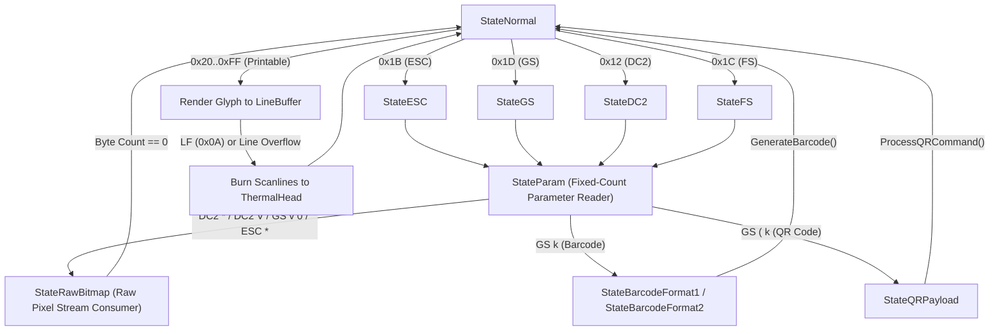

# ThermalSim — Byte-Accurate State Machine Design Reference

## 1. State Machine Topology

The `ThermalSim` core parser processes input strictly byte-by-byte via `FSM.Step(b byte)`. It never uses regex, line tokenization, or lookahead buffering.

---

## 2. Line Buffer Mechanics
- **Width:** Fixed 384 dots (48 bytes per line at 8 dots/mm).
- **Height:** Dynamic (24 dots for standard Font A, 17 dots for Font B, up to 48 dots for Double-Height).
- **Cursor Tracking:** `cursorX` tracks the pixel dot column ($0 \dots 384$), while `cursorCol` tracks the character column index.
- **Line Wrap:** If a character's width causes `cursorX + charWidth > 384`, the line buffer is automatically flushed to the `ThermalHead` and paper is advanced by `LineSpacing` dots.

---

## 3. Thermal Physics & Motor Timing Formulas
When a row of dots is burned to the paper, the duration is computed dynamically:
$$T_{\text{row}} = N_{\text{strobe}} \times (T_{\text{heat}} + T_{\text{interval}}) + T_{\text{break}} + T_{\text{step}}$$
Where:
- $N_{\text{strobe}} = \lceil \text{activeDots} / (8 \times (n_1 + 1)) \rceil$
- $T_{\text{heat}} = n_2 \times 10\,\mu\text{s}$ (default 800 µs)
- $T_{\text{interval}} = n_3 \times 10\,\mu\text{s}$ (default 20 µs)
- $T_{\text{break}} = \text{D7..D5} \times 250\,\mu\text{s}$
- $T_{\text{step}} = 2100\,\mu\text{s}$ (stepper motor physical advance time, ~2.1 ms)

In real-time mode (`--realtime`), this formula governs execution delays, causing unthrottled host byte streams to overrun the 4KB (or 256B) ring buffer and reproduce hardware desynchronization bugs.
